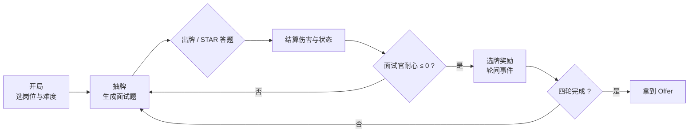

# 面试尖塔 · InterviewSpire

> 一款以「求职面试」为主题的单机 Roguelike 策略卡牌 Demo。把每个面试官想象成一个 Boss：用卡牌回答面试题、削减对方的「耐心」，连过四轮拿到 Offer。

**类型**：单机 / 卡牌构筑 / Roguelike　　**引擎**：团结引擎 · Unity 2022.3 LTS　　**语言**：C#　　**用途**：个人学习与原型演示

---

## 核心玩法循环



玩家每回合拥有固定精力，用手牌造成「自信伤害」、获得镇定或施加负面状态；打出的牌若与当前题目类型契合，伤害 ×1.5。击败一位面试官后从三张奖励牌中选一张（或跳过恢复自信），并触发一次轮间事件。四轮全过即通关。

## 游戏内容

| 项目   | 内容                                 |
| ---- | ---------------------------------- |
| 面试官  | 4 位，耐心依次为 50 / 64 / 78 / 96，各有专属机制 |
| 卡牌   | 56 张，含攻击 / 技能 / 状态类，分普通 / 进阶 / 稀有  |
| 岗位方向 | 软件开发、市场营销、管培生、产品设计（影响题型权重）         |
| 难度   | 轻松 / 标准 / 硬核（自信 30 / 20 / 15）      |
| 题库   | 6 类题型、90 道题目元数据，按岗位权重展开            |
| 事件   | 5 类轮间事件（休息、练习、精简卡组等）               |
| 其他   | 卡牌图鉴、多存档、跨局统计、新手引导、特效与音量开关         |

### 四位面试官

| 轮次 | 面试官   | 耐心 | 专属机制             |
| -- | ----- | -- | ---------------- |
| 1  | 简历追问官 | 50 | 每 3 回合施加一次自我怀疑   |
| 2  | 技术面试官 | 64 | 打出技术牌后，下次攻击 +4   |
| 3  | 压力面主管 | 78 | 每 2 回合随机弃掉 1 张手牌 |
| 4  | 终面合伙人 | 96 | 每 3 回合攻击额外 +4    |

## 操作方式

| 操作      | 方式                          |
| ------- | --------------------------- |
| 出牌      | 双击手牌，或按住拖到面试官区域松手           |
| 快速出牌    | 数字键 `1`–`8`                 |
| 结束回合    | `Enter` / `Space`，或点击「结束回合」 |
| 回答题目    | 点击「STAR · 回答本题」（非强制，可只出牌）   |
| 存档 / 读档 | 顶栏「存档」「读档」，退出时自动存档          |

## 运行

### 方式一：直接玩（Windows）

双击根目录下的 `面试尖塔.exe`（Unity 版为 `Unity版/InterviewSpire.exe`）即可运行，无需安装引擎。

### 方式二：打开工程源码

1. 用 Unity Hub / 团结引擎打开 `Unity版/InterviewSpireUnity` 目录；
2. 已验证版本：团结引擎 2022.3.62t18，Unity 2022.3 LTS 同版本线亦可；
3. 首次打开时 `ProjectBootstrap` 会自动创建主场景并加入构建列表；
4. 打开任意空场景按 Play 即可运行——`GameBootstrap` 会自动挂载控制器与界面，无需手动挂脚本。

## 项目结构

```
游戏demo/
├── Unity版/
│   ├── InterviewSpire.exe          # 可直接运行的构建产物
│   └── InterviewSpireUnity/        # Unity 工程源码
│       ├── Assets/
│       │   ├── Scripts/
│       │   │   ├── Core/           # GameController、GameState、SaveSystem、Bootstrap
│       │   │   ├── Data/           # GameDatabase（读取 game_data.json）
│       │   │   ├── UI/             # GameUI（运行时搭建 UGUI）、CardDragHandler
│       │   │   └── Editor/         # 自动建场景、资源导入、构建与验证脚本
│       │   ├── Resources/Art/      # 卡牌插画、面试官、背景、UI、特效
│       │   └── StreamingAssets/
│       │       └── game_data.json  # 卡牌 / 题库 / 事件 / 数值配置
│       └── README.md               # 开发记录与移植细节
├── 源码/                           # 早期 Python / Tkinter 原型
├── 美术资源/                       # 卡牌插画、图标等原始素材
├── 文档/
└── data.json                       # Python 版数据
```

## 技术实现

- **数据驱动**：卡牌、题目、事件、面试官数值全部来自 `game_data.json`，改配置即可扩展内容，无需改代码。
- **界面分层**：核心逻辑 `GameController*` 与界面 `GameUI*` 分离；UGUI 界面由代码运行时搭建，配合 TextMeshPro 渲染文本。
- **存档系统**：`JsonUtility` 序列化，命名存档 + 时间戳，手动存档保留最近 10 个，通关或重开按 `runId` 清理本局存档。
- **自动化验证**：`UiFlowSmoke` 覆盖开局设置往返、出牌、拖拽、结算等主流程；`BalanceSimulator` 用于数值模拟；`BuildScript` 一键构建桌面端。

## 说明

本项目为个人学习 / 演示用途的原型 Demo，单机运行，不含付费、抽卡、联网或数据采集功能。美术素材用于本地演示。
